# fireball-flux

[](https://github.com/aneeshkaravadi/fireball-flux/actions/workflows/ci.yml)

How often do space rocks big enough to make a fireball hit Earth, and can simple atmospheric-entry physics predict how high they explode? I worked through both questions with NASA's public fireball table (1,074 events detected by U.S. Government sensors since 1988).

## Short answers

- **About four a year at 1 kiloton of TNT or more.** Over 2000-2020 the table has 84 events at or above 1 kt, which is 4.0 ± 0.4 per year. Above 0.21 kt the rate follows a power law, N(≥E) = 4.0 E^-0.96 per year. That is within one standard deviation of the law Brown et al. published in 2002 (N = 3.7 E^-0.9), but only if the sensors now see close to the whole Earth. Brown et al.'s law is probably corrected for the 60-80% of the Earth the sensors covered in their years. If today's coverage were 80%, my rate at 1 kt would be 5.0 a year, 2.7 standard deviations above theirs.
- **Simple physics doesn't predict the burst altitude of any one rock.** If every rock had the same strength, the air density where it bursts would scale as 1/v². In the data, speed explains only 8% of the spread in burst altitude. A pancake-breakup model with one strength for everything does worse than just guessing the average altitude. The strength the model needs to match each reported altitude spans a factor of 10 (1.1 to 11 MPa for the middle 68%), and I can't separate how much of that is the rocks and how much is error in the reported altitudes and speeds.
- **For Chelyabinsk, the altitude in NASA's table is 6.4 km lower than the one from video.** The table puts peak brightness at 23.3 km; the video trajectory in Popova et al. (2013) puts it at 29.7 ± 1.4 km. That one difference changes the strength my model infers by a factor of 13. The direction of the two trajectories agrees to within 0.4°.

## The data

The [CNEOS fireball table](https://cneos.jpl.nasa.gov/fireballs/intro.html) lists bright fireballs seen by U.S. Government sensors: the time, the total radiated (optical) energy, an estimated total impact energy, and, for some events, the location, the altitude of peak brightness and a velocity vector. I downloaded all of it from the [Fireball Data API](https://ssd-api.jpl.nasa.gov/doc/fireball.html) (version 1.2) on 2026-10-29 and committed it as [`data/cneos_fireballs_2026-10-29.csv`](data/cneos_fireballs_2026-10-29.csv), exactly as the API returned it. The 1,074 events run from 1988-04-15 to 2026-10-04. 888 have a location, 602 an altitude, and 360 both an altitude and a velocity. CNEOS says the list isn't meant to be complete; only the brightest fireballs are in it.

## 1. How often they hit

### Which years to use

Before fitting anything I checked how the yearly count changes over time. There are only a handful of events before 1994, and 1994-1999 averages 21.8 a year against 35.2 a year for 2000-2025. From 2000 on, the yearly totals are consistent with one constant Poisson rate (index of dispersion 0.98, p = 0.49).

But the energies shift in the last five years. The total stays the same (35.2 a year in 2000-2020, 35.0 in 2021-2025), and so does the rate at 1 kt or more (4.0 and 4.0). In between, events move down in energy:

| impact energy | 2000-2020, per year | 2021-2025, per year |
|---|---|---|
| below 0.1 kt | 5.8 | 8.0 |
| 0.1-0.24 kt | 13.2 | 16.2 |
| 0.24-1 kt | 12.1 | 6.8 |
| 1 kt and up | 4.0 | 4.0 |

The median energy drops from 0.21 to 0.16 kt, and a two-sample KS test on all the energies gives p = 4 × 10⁻⁴. I only noticed this after looking at the table, so that p-value overstates how surprising it is. With the total count unchanged, it looks more like a change in the sensors, the energy calibration or the reporting than in the rocks, but I can't check that. Either way, a fixed energy threshold doesn't mean the same thing before and after 2021, so I fit the 21 full years 2000-2020 and show 2000-2025 next to it. 2026 is left out because the year isn't over.

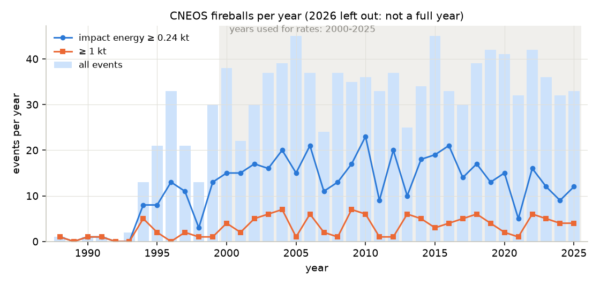

### Which energies to use

The sensors miss more of the faint events, so below some energy the table is incomplete and the power law bends over. I picked the threshold the way Clauset, Shalizi & Newman (2009) recommend: fit the power law above each candidate threshold by maximum likelihood, and keep the threshold where the fitted law is closest to the data (smallest Kolmogorov-Smirnov distance). That gives 0.21 kt, with 385 events at or above it.

CNEOS prints impact energies to two significant figures, so a printed 0.21 kt stands for anything from 0.205 kt up. I use 0.205 kt as the lower bound in the fit. Treating the printed 0.21 as exact gives b = 0.980 instead of 0.957, because the events sitting right at the threshold look closer to it than they are.

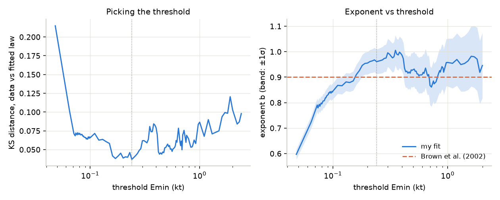

### The fit

N(≥E) = N₁ E^-b, with E in kilotons of TNT and N per year over the whole Earth:

| | threshold | b | N₁ (per year at ≥ 1 kt) |
|---|---|---|---|
| My fit, 2000-2020 | 0.21 kt | 0.957 (68%: 0.883-1.02; 95%: 0.784-1.10) | 4.02 (68%: 3.58-4.35) |
| Only events after Brown et al. (2003-2020) | 0.21 kt | 0.961 (0.874-1.03) | 4.01 (3.56-4.42) |
| 2000-2025, including the shifted years | 0.23 kt | 0.948 (0.886-0.999) | 3.86 (3.51-4.19) |
| Brown et al. (2002) | | 0.9 | 3.7 |

The intervals come from 2,000 bootstrap resamples of the whole catalog, with the total count drawn from a Poisson distribution and the threshold chosen again in every resample, as Clauset et al. recommend (the threshold's own 68% range is 0.19 to 0.42 kt). Holding the threshold fixed at 0.21 kt would give a narrower 0.912-1.01 for b, so the threshold choice is a big part of the uncertainty. Including 2021-2025 flattens b a little, as you'd expect from losing events just above the threshold. A goodness-of-fit test (Clauset et al.'s bootstrap, with the synthetic catalogs rounded to two significant figures like the CNEOS table) gives p = 0.20, so the power law isn't ruled out.

My exponent is 0.74 bootstrap standard deviations steeper than Brown's (0.90 sits at the 22nd percentile of my bootstrap), and N₁ is 0.8 standard deviations higher. Brown et al. used 8.5 years of satellite records up to 2002, so the 2003-2020 row uses only events they couldn't have seen.

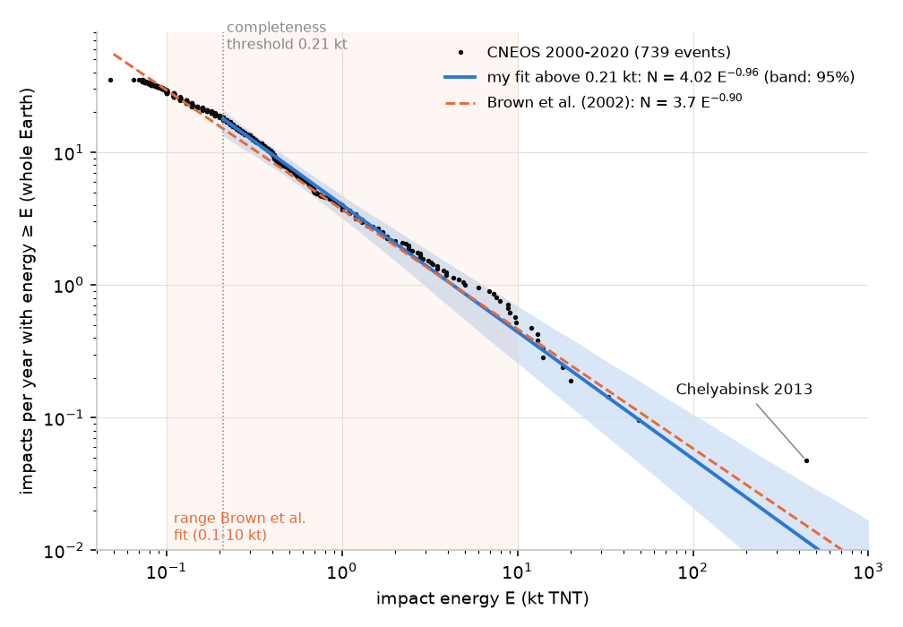

### Is that agreement real?

Only if the sensors see close to the whole Earth. Brown et al.'s law is probably corrected for sensor coverage, and my rates aren't. Devillepoix et al. note that Brown et al. mention 60-80% Earth coverage for their 1994-2002 data. I can't read the paywalled paper to see exactly what was corrected, but the raw table points the same way. Devillepoix et al. date the end of Brown's study to September 2002, so I took the 8.5 years before that (March 1994 to August 2002). Over those years the raw rate is 0.60 of Brown's law at 1 kt or more (19 events), 0.68 at 3 kt or more (8 events), and 0.90 at 0.3 kt or more (84 events). Brown's law sits above the raw counts of its own years, which is what a coverage correction would do.

Devillepoix et al. also found that the yearly count went up about 40% after September 2002, which they say would suggest full coverage after that. If so, my uncorrected rates since 2000 can be compared directly with Brown's corrected law, and they agree. But Corral & González, citing Brown et al. (2013), say coverage may be on the order of 80% for events above 1 kt. In that case my N₁ becomes 5.0 ± 0.5, 2.7 standard deviations above Brown's 3.7. I can't tell which is right from this table.

Two other comparisons:
- **Counting directly**, with no fit: 84 events at or above 1 kt in 21 years, 4.0 ± 0.4 per year.
- **Corral & González** fit the same table (1994 to July 2018) and got a differential exponent of 2.022 above 0.3 kt from 278 events, which is b = 1.02 in my notation. Above the same 0.3 kt my b is 1.00 ± 0.06, 0.4 standard errors from theirs. Their bootstrap with the threshold chosen again each time gives 1.95 ± 0.35 for the differential exponent.

### What it means

| | my fit (68% range) | Brown et al. law |
|---|---|---|
| Energy hit about once a year | 4.28 kt (3.55-5.19) | 4.28 kt (their abstract: about 5 kt) |
| Years between events ≥ 440 kt (Chelyabinsk size) | 84 (50-136) | 65 |
| Years between events ≥ 10 Mt (Tunguska size, as Brown et al. take it) | 1,680 (790-3,290) | 1,080 (their abstract: about 1,000) |

The last two rows are extrapolations, and they carry the coverage question above with them. Brown et al. say their law applies from 0.1 to 10 kt. Above my threshold, every event but one is 49 kt or less (the exception is Chelyabinsk, 441 kt), and 10 Mt is more than 20 times Chelyabinsk. The small difference in exponent turns into a factor of 1.6 at 10 Mt.

### Limits of this part

- The rates aren't corrected for the fraction of the Earth the sensors watch (see above).
- The 2021-2025 energy shift. I don't know what caused it.
- Every impact energy in the table comes from the radiated energy through one formula (next section), so any error in that formula moves the whole curve.

## 2. Where the impact energies come from

The satellites measure light. CNEOS turns the radiated energy E₀ into a total impact energy E with an empirical fit from Brown et al. (2002), given on the [CNEOS fireball page](https://cneos.jpl.nasa.gov/fireballs/intro.html):

E = 8.2508 E₀^0.885 (both in kt, 1 kt = 4.185 × 10¹² J)

This is the same fit as a luminous efficiency τ = E₀/E = 0.1212 E₀^0.115, which is how Hibberd (2023) quotes it, with 8.2508 = 1/0.1212 and 0.885 = 1 − 0.115. Applying it to the radiated-energy column and rounding to the precision the table prints (two significant figures; the one event above 100 kt, Chelyabinsk, gets three) reproduces 1,073 of the 1,074 impact energies exactly. The one exception (2013-02-20, 3.2 × 10¹⁰ J) is listed as 0.1 kt where the formula gives 0.11, so it was rounded to one figure. Over the table the formula implies that 6% to 20% of the energy came out as light.

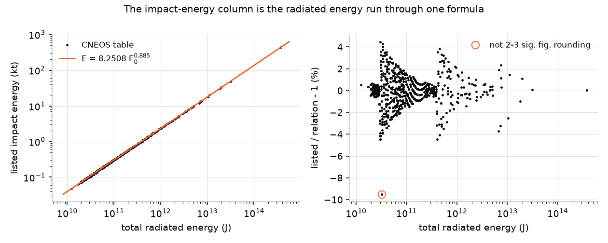

To be clear about what this shows: it is a check of how the column was made, not an independent check that the impact energies are right. It confirms that the second energy column carries no information the first one doesn't.

## 3. How high they explode

360 events have both an altitude of peak brightness and a velocity vector. I worked out each entry angle from the vector and the location. Five of the vectors point upward, away from the ground, which can't be right for something hitting the atmosphere, and five more are under 5° from horizontal, where my model is worst. That leaves 350. Their peak-brightness altitudes are 26 to 42 km for the middle 68%, with a median of 33 km.

### Level 1: ram pressure

A rock breaks when the pressure of the air piling up in front of it, ρv², exceeds its strength. At the reported altitude and speed that pressure is 1.0 to 10.4 MPa for the middle 68% (median 3.3 MPa).

If every rock had the same strength Y, it would break where ρ(z) = Y/v², so ln ρ at the burst would fall with ln v with a slope of exactly -2. In the data:

| | slope of ln ρ(burst altitude) vs ln v | 95% interval |
|---|---|---|
| least squares | -1.31 | -2.14 to -0.42 (bootstrap) |
| Theil-Sen (median of pairwise slopes) | -0.75 | -1.22 to -0.26 |
| same strength for everything | -2 | |

Faster rocks do burst higher, as they should, but less steeply than one strength predicts, and speed explains only 8% of the variance (r² = 0.084). The least-squares interval just reaches -2; the outlier-resistant fit excludes it. Errors in the reported speeds would flatten the slope too, so some of the gap could be the data rather than the rocks.

### Level 2: a pancake model

I wrote an entry model following Collins, Melosh & Marcus (2005), the Earth Impact Effects Program, which uses the "pancake" picture of Chyba, Thomas & Zahnle (1993). The rock flies in a straight line and slows from drag. When ρv² reaches its strength it is crushed, and the crushed mass spreads sideways under the pressure difference until it is 7 times its original width (Collins et al.'s "pancake factor"). I integrate it numerically through the U.S. Standard Atmosphere 1976 (continued exponentially above 86 km, where it hardly matters) and call the burst altitude the point where the rock is losing energy fastest, which I compare with the reported altitude of peak brightness. Size comes from the impact energy and an assumed density of 3,000 kg/m³ (the bulk density Brown et al. assume for converting telescope sizes to energies).

For the 350 events the model uses a flat Earth, with each event's angle taken at its reported altitude, because the breakup and spreading that set the burst altitude happen in the last few scale heights above it. I checked that against a straight path over a round Earth (the method is in section 4) for the 30 shallowest events (5° to 16°): the strengths changed by at most 4% (median 0.4%), and none moved between the groups below.

With one strength for every rock, the best choice is 3.2 MPa, and the model's burst altitudes then miss by 10.0 km RMS. The data's own spread is 9.5 km, so the model does worse than predicting the average for everything. The single-strength ram-pressure version does slightly better than the average (9.1 km). The pancake model makes big rocks burst much lower than small ones at the same strength, and the data doesn't show that: burst altitude has almost no correlation with impact energy (Spearman ρ = -0.08, p = 0.14).

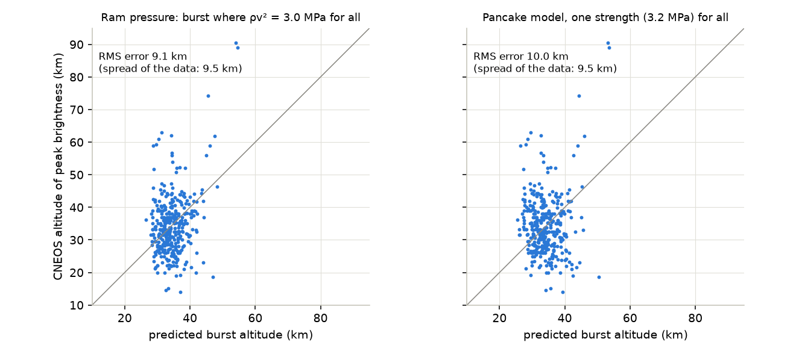

So instead I ran the model backwards: for each event, which strength puts the model's burst at the reported altitude?

**The model's burst altitude isn't quite monotonic in strength.** A stronger rock breaks lower, and as long as it breaks above the altitude where an unbroken rock would peak, it also bursts lower. But a rock that only just breaks up does so below that altitude, and the spreading pieces then peak right there, lower than a slightly weaker or a slightly stronger rock would. One step stronger, it doesn't break at all and peaks higher again. On my strength grid (10 values per factor of 10) this dip shows up for 138 of the 350 events, by more than 500 m for 93 of them and by up to 2.75 km. The inversion follows the lower edge of the curve, so it returns the weakest strength that fits.

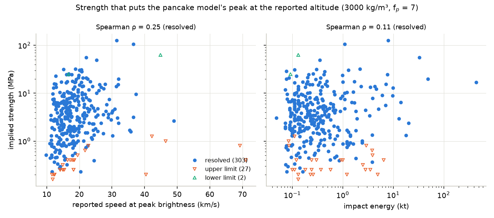

Of the 350 events, 308 land on the sloped part of the curve and give a definite strength. For 34 the reported burst is at or above the altitude where even a very weak rock would peak, so only an upper limit comes out, and 8 burst lower than the model can put them with any strength. In 18 (spread across those groups) the model couldn't match both the altitude and the speed (see below), and I leave those out. One of them (2012-09-10) also sits in the dip, where a second, stronger value would fit too. That leaves 303 definite strengths:

| | 5% | 16% | median | 84% | 95% |
|---|---|---|---|---|---|
| strength (MPa) | 0.50 | 1.06 | 3.52 | 11.2 | 22.8 |

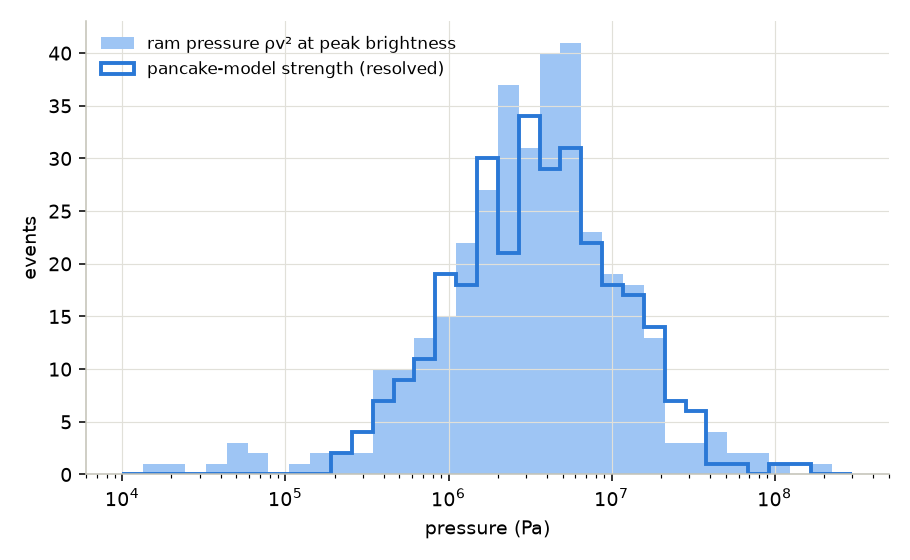

Implied strength rises with speed (Spearman ρ = 0.25, p = 2 × 10⁻⁵). That is the same flat slope as above, seen from the other side: fast rocks don't burst as high as one strength predicts, so the model needs them to be stronger. It barely depends on energy (ρ = 0.11, p = 0.06).

How much of the factor-of-10 spread is the rocks? Section 4 shows that a 6.4 km error in one reported altitude changes the implied strength by a factor of 13, and Devillepoix et al. estimate that errors in the reported speeds alone can make strengths wrong by a factor of 2 (see section 5). So a good part of the spread, maybe most of it, could be error in the data. I can't separate the two.

**What the speed means matters.** The CNEOS fireball page describes the table as giving each event's "altitude and velocity at peak brightness", but the next sentence calls them "pre-impact velocity components". Its 2013 Chelyabinsk page lists 18.6 km/s as the "velocity at peak brightness", and the API documentation says all fields are relative to the peak-brightness event, while its July 2025 change log relabels the components as "entry velocity" components. In my model a rock has already slowed down by peak brightness, so I tried both readings:
- **Speed at peak brightness:** I solve for the entry speed that makes the model's speed at the burst equal the reported one. The model needs entry speeds a median 17% higher (7% to 46% for 90% of events). That is the table above.
- **Entry speed:** taking the reported speed as the speed at 100 km gives a median of 2.6 MPa (0.84 to 7.0 MPa for the middle 68%).

On synthetic rocks (flown through the model with known strengths, then inverted from the burst altitude and the speed there), treating that speed as the entry speed gave strengths a median 0.71 of the true ones, while the matching got them back. That's the reason for the matching. But Chelyabinsk (next section) suggests the model slows big rocks down too much, which would make the matching overcorrect. I'd put the typical strength somewhere between 2.6 and 3.5 MPa.

Other assumptions moved the median less:

| change | median strength |
|---|---|
| baseline (3,000 kg/m³, pancake factor 7, speed matched) | 3.52 MPa |
| density 1,500 kg/m³ | 3.55 MPa |
| density 3,300 kg/m³ | 3.54 MPa |
| pancake factor 4 | 4.48 MPa (only 230 events resolved) |
| reported speed taken as entry speed | 2.60 MPa |

Collins et al. say the real pancake factor is probably only 2 to 4, and picked 7 after experimenting with the model, so 4 is a fair alternative.

## 4. Chelyabinsk

The biggest event in the table is the 15 February 2013 airburst over Chelyabinsk, Russia. It is also the one with the best independent analysis, Popova et al. (2013), which reconstructed the trajectory from calibrated videos.

| | CNEOS table | Popova et al. (2013) |
|---|---|---|
| altitude of peak brightness | 23.3 km | 29.7 ± 1.4 km (2σ) |
| speed | 18.6 km/s (from the vector) | 19.16 km/s at entry; satellites measured 18.6 km/s at peak radiation |
| entry angle above horizontal, at 97.1 km | 18.1° (the CNEOS line followed back up) | 18.3 ± 0.4° |
| radiant azimuth from north, at 97.1 km | 102.9° | 103.2 ± 0.4° (they give 283.2° from south) |
| energy | 441 kt (from 3.75 × 10¹⁴ J radiated) | 590 ± 50 kt from the same satellite light with a different calibration; 570 ± 150 kt from infrasound |
| diameter | | 19.8 ± 4.6 m at 3.3 g/cm³ |

**The direction agrees.** Popova et al. give the angle and azimuth where the fireball was first seen, at 97.1 km. The CNEOS vector gives 15.9° and 99.9° at its own peak-brightness point, which is 252 km further along the path. A straight path over a round Earth meets the local horizontal at a different angle at every point, so those numbers can't be compared directly. Following the CNEOS line back up to 97.1 km gives 18.1° and 102.9°, 0.23° and 0.34° from Popova et al.'s values and inside their 2σ (rounding the CNEOS numbers moves these by about 0.1°). The speeds agree too. The altitude and the energy don't. Popova et al. say all their energy values are uncertain by a factor of two. They also report that two main fragments survived the disruption at 29.7 km and flared around 24 km, close to the CNEOS altitude, and Devillepoix et al. note that a wrong peak height usually means the sensors recorded a different peak in the light curve. I can't tell from the table which part of the event the satellites' altitude refers to.

Every Chelyabinsk run here flies a straight path over a round Earth instead of the flat-Earth model of section 3. Measured along the path, none of the model's equations involve the angle, so the round Earth only changes how fast the air density rises along the path; `entry.straight_path` re-maps the density and reuses the same integrator, and a test checks it against scipy integrating the same equations in time along the real line. With Popova et al.'s inputs (19.16 km/s and 18.3° at 97.1 km, 590 kt, 3.3 g/cm³):
- The strength that puts the burst at 29.7 km is **0.57 MPa**. Popova et al. modeled the light curve with fragmentation starting at **0.2 MPa** (and the rock tolerating more as the pieces got smaller). Given 0.2 MPa, my model breaks it up at 55.3 km and puts the burst at 30.8 km, inside their 2σ. Popova et al. say fragmentation started around 83 km and sped up at 54 km.
- But at the burst my model has slowed it to 15.8 km/s, where the satellites measured 18.6. The model drags the crushed rock too hard. To match 18.6 km/s at 29.7 km it would need an entry speed of 22.4 km/s, not 19.16, and then the strength comes out at 1.4 MPa.

With the CNEOS numbers the implied strength is 16 MPa, about 29 times more. Swapping in the CNEOS values one at a time shows where that comes from:

| inputs | implied strength |
|---|---|
| Popova et al. | 0.57 MPa |
| + CNEOS altitude (23.3 km) | 7.4 MPa |
| + the CNEOS trajectory line instead of Popova's | 7.6 MPa |
| + CNEOS energy (441 kt) | 8.5 MPa |
| + matching the CNEOS speed at the burst (needs 24.6 km/s at entry) | 16.2 MPa |

The altitude alone does almost all of it, and the trajectory line barely matters because the two agree. In plain ram-pressure terms, moving the peak from 29.7 to 23.3 km raises ρv² by a factor of 2.7, since the air gets denser by a factor of e about every 6.3 to 6.5 km there. In the pancake model the factor is 13: for a 20 m rock the burst altitude moves only slowly with strength, so matching a lower burst takes a much stronger rock. Either way, a few km of error in a reported altitude is a big error in strength, and that limits everything in section 3.

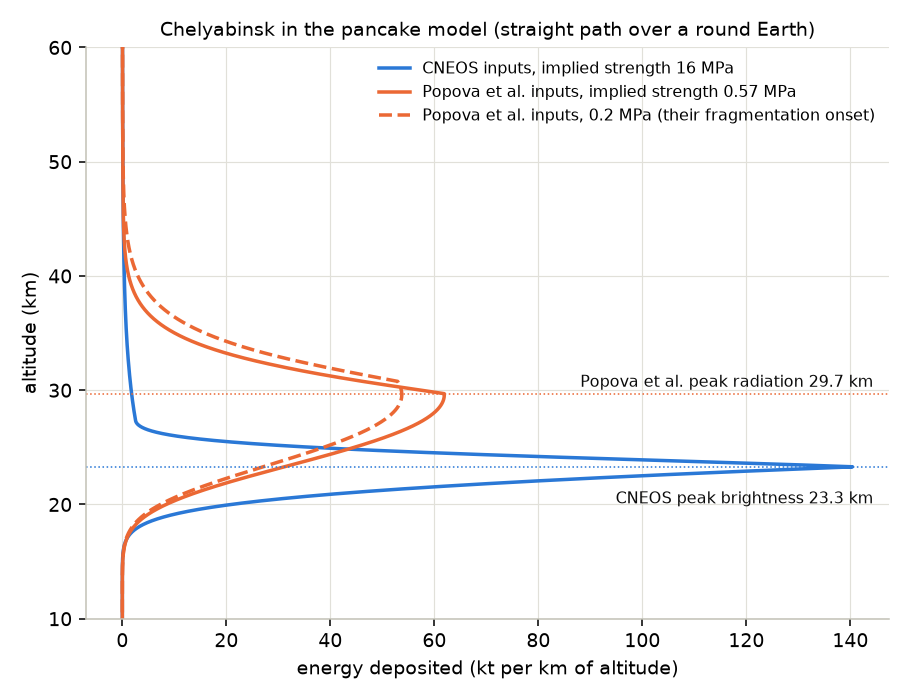

## 5. Other things in the data

**Speeds.** The 363 reported speeds have a median of 17.4 km/s and a mean of 18.9 km/s (90% between 11.8 and 31.2 km/s). Brown et al. (2002) assumed an average of 20.3 km/s to turn telescope sizes into energies. If the reported speeds are at peak brightness, my model's entry speeds average 22.9 km/s, but given the Chelyabinsk result that is probably too high.

**Entry angles** look isotropic. For rocks arriving from random directions, the fraction hitting at less than h above the horizon is sin²h, so the median should be 45°. The 358 CNEOS angles (each at its peak-brightness point) have a median of 43.4°, and a KS test against sin²h gives p = 0.23.

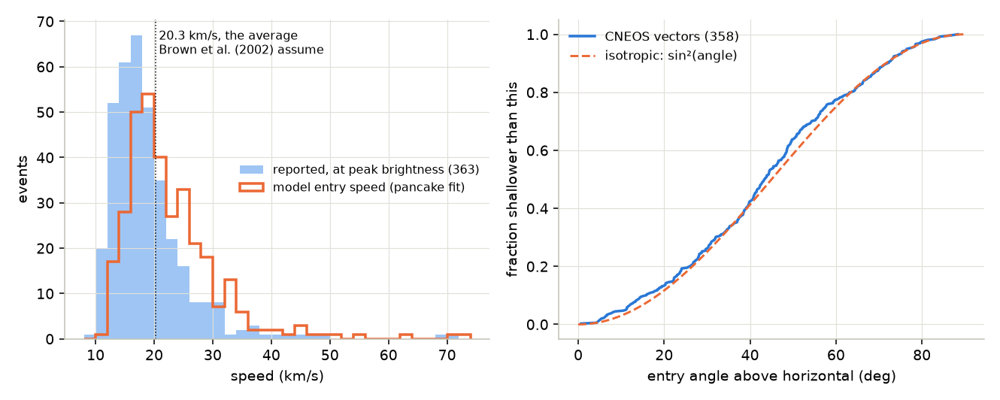

**Where they are.** The 888 located events are spread evenly over the globe: 49.3% in the northern hemisphere, 50.3% within 30° of the equator (an even spread over a sphere gives exactly 50%), and KS tests against a uniform sphere give p = 0.23 in latitude and p = 0.95 in longitude. So the sampling doesn't favor any region that I can detect.

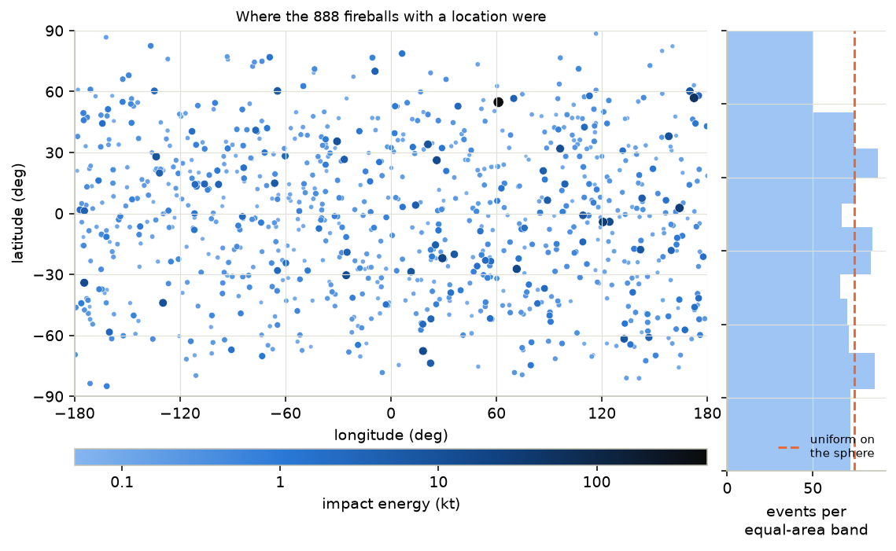

**When they are.** By local solar time the events are not uniform: more around midnight and late morning than at dawn and in the late afternoon (χ² test over 3-hour bins, p = 2 × 10⁻⁵). Above the 0.21 kt threshold the pattern looks similar (p = 0.004). I can't tell from this data whether that comes from the sensors or the rocks.

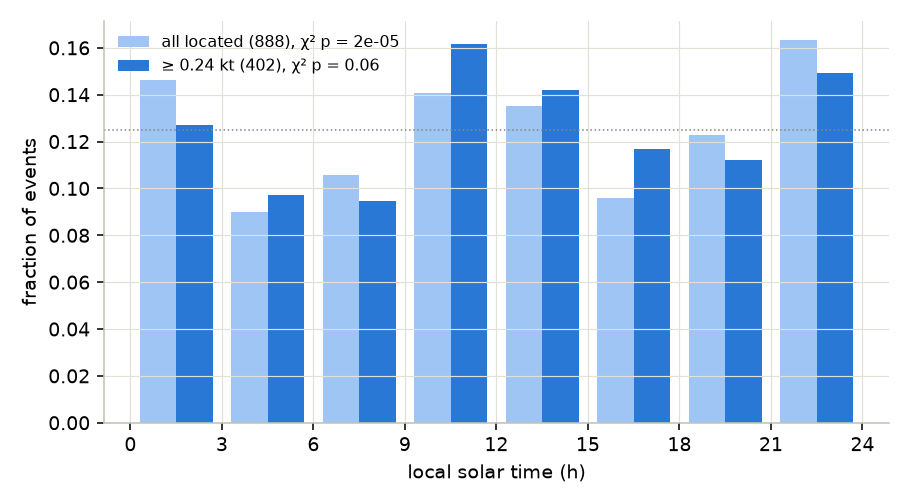

**Which events get a velocity.** 333 of the 363 velocity vectors are from 2008 on, and even then not every event has one. Over 2008-2025 the events with a velocity are more energetic (median 0.23 kt against 0.16 kt without, Mann-Whitney p = 5 × 10⁻⁹). So section 3 is about the brighter events, not a random sample.

**Data quirks I ran into:**
- The API also returns a field called `vel` that isn't in its documentation (the change log says the derived speed was removed in version 1.1). For 9 of the 363 events it disagrees with the length of the velocity vector. The worst is the 18 December 2018 Bering Sea fireball: `vel` says 13.6 km/s, the components give 32.0 km/s, and CBC News reported JPL's estimate as 32 km/s. I always use the components.
- Five velocity vectors point upward, as mentioned above.
- The API time for Chelyabinsk is 03:20:26 UTC. CNEOS's own 2013 page gives 03:20:33 and Popova et al. give 03:20:32.2 for peak radiation.

Devillepoix et al. compared the government-sensor data with fireballs whose trajectories were measured independently. They found the reported velocity vectors unreliable enough that they don't trust them for working out orbits, with speeds off by as much as 28%. They estimate that the speed errors make strengths wrong by up to a factor of 2, and conclude that strength errors stay within an order of magnitude, which is good enough to tell iron, chondritic and cometary bodies apart. An order of magnitude is about the whole spread of implied strengths in section 3. They also say the reported height of peak brightness is wrong for Chelyabinsk, which matches section 4.

## What the model leaves out

- Ablation: the rock loses no mass as it flies.
- More than one breakup. Real rocks fragment in stages and get stronger as the pieces get smaller (Popova et al. model Chelyabinsk that way). Mine breaks once at one strength.
- Gravity. Paths are straight lines. Section 3 also uses a flat Earth with each angle taken at the reported altitude; the round-Earth check above says that costs at most 4% in strength for the shallowest events. Entries under 5° are dropped.
- Any link between brightness and energy deposition beyond "peak brightness = peak energy loss".
- Uncertainty in the reported altitudes and speeds, which I don't propagate. The Chelyabinsk comparison suggests altitude errors of several km are possible.
- Sensor coverage, for the rates.

## How it's checked

`pytest -q` runs 60 checks in about 12 s, all offline:

- **API parsing** on 12 real records saved from the API, including Chelyabinsk against the numbers on CNEOS's 2013 page and the Bering Sea speed against the 32 km/s JPL figure in the CBC report.
- **Energy relation** coefficients against the CNEOS page and Hibberd (2023), and Chelyabinsk's 90 kt radiated and 440 kt impact energy against the CNEOS page.
- **Power-law fitting** on synthetic samples with known exponents: the maximum-likelihood fit recovers them, including from a catalog rounded to two significant figures (where treating the printed threshold as exact is shown to bias b upward); the bootstrap 68% interval covers the true exponent at the right rate over 200 synthetic catalogs (the test allows 58-78%); choosing the threshold again in each resample widens the interval; the threshold choice finds the edge of a synthetic incomplete catalog; and the goodness-of-fit test accepts a synthetic power law and rejects a synthetic lognormal. Brown et al.'s law against the two numbers in their abstract.
- **Atmosphere** against 13 densities from the printed US76 tables (to 6 × 10⁻⁵, the precision of the table), plus the sea-level and tropopause values and the isothermal scale height.
- **Geometry**: the straight-line trace against the closed form (R + z) cos(angle) = constant.
- **Entry model** against Collins et al.'s closed form for an unbroken rock, their breakup-altitude approximation (within 50 m), and a scipy solve of the pancake equation (within 20 m). Collins et al.'s own closed form for the pancake altitude lands 2.3 km below to 0.5 km above the exact solution over 27 cases; the test records that instead of hiding it. The straight path over a round Earth against a scipy solve in time along the real line (within 10 m for breakup and 40 m for the burst). Also: energy is conserved, the step size is converged, the burst altitude falls with strength while the rock breaks up above an unbroken rock's peak, the dip where breakup stops is there and is caught by the crossing count, and the inversion recovers known strengths and entry speeds on synthetic rocks.
- **Chelyabinsk** against Popova et al.: the direction at 97.1 km (inside their 2σ plus rounding), the burst altitude with their 0.2 MPa (inside their 2σ), and the model's too-low speed at the burst written down as a test.

## Running it

```bash
pip install -e ".[dev]"
pytest -q                          # 60 checks, ~12 s, no network
python examples/make_figures.py    # every figure and number above, about 100 s on one core
python examples/fetch_data.py      # optional: download a fresh, dated snapshot from the API
```

Every number derived from the data is in [`docs/results.json`](docs/results.json), which `make_figures.py` writes. Test tolerances are in the tests.

## What I got wrong

- **My entry model blew up for small rocks on shallow paths.** I first stepped the speed itself with RK4. Once a crushed rock is low in the atmosphere the drag gets so strong that a 25 m step is unstable, the power overflowed, and the overflow showed up as a fake "burst" a few km above the ground for two real events. I found it from overflow warnings during the first inversion over the whole table. Integrating ln v instead fixed it, because its rate of change doesn't depend on itself, and there's now a test for those two cases.
- **I compared Chelyabinsk's angles at two different points.** My first version put CNEOS's angle at the peak-brightness point next to Popova et al.'s at 97 km, reported a 2.4° and 3.3° disagreement, and had a test asserting it. Over the 252 km between those points a straight path's angle changes by more than 2°. Compared at the same point, they agree. I made the same mistake in the model runs: I used Popova et al.'s 97 km angle in the flat-Earth model as if it held all the way down, which made their implied strength 0.17 MPa instead of 0.57 and the altitude effect a factor of 36 instead of 13. That's why the Chelyabinsk runs now fly a straight path over a round Earth.
- **I treated the printed threshold as an exact lower bound** and held it fixed in the bootstrap. The first makes b too steep by about 0.02. The second left out the threshold's own uncertainty, so the spread in b looked about a third smaller than it is (0.050 against 0.078). For 2000-2025 my first version put b 1.2 standard deviations from Brown's; done properly, the same years give 0.8.
- **I claimed the burst altitude never rises as strength increases.** A test on three hand-picked rocks passed, but on the real inputs the curve dips where breakup stops, for 138 of the 350 events.
- **I cited a review chapter as part of a book I hadn't checked.** The preprint I actually read doesn't say where it was published, so I cite the arXiv number.

## Sources

- CNEOS fireball data and the impact-energy relation: [cneos.jpl.nasa.gov/fireballs/intro.html](https://cneos.jpl.nasa.gov/fireballs/intro.html); API documentation: [ssd-api.jpl.nasa.gov/doc/fireball.html](https://ssd-api.jpl.nasa.gov/doc/fireball.html); Chelyabinsk details: [cneos.jpl.nasa.gov/news/fireball_130301.html](https://cneos.jpl.nasa.gov/news/fireball_130301.html)
- Brown, Spalding, ReVelle, Tagliaferri & Worden (2002), The flux of small near-Earth objects colliding with the Earth, *Nature* 420, 294-296, [doi:10.1038/nature01238](https://doi.org/10.1038/nature01238). The paper is paywalled; I read the abstract and figure captions, and took the fit N = 3.7 E^-0.9 (E in kt, 1 kt = 4.185 × 10¹² J, valid 0.1-10 kt) from Borovička, Spurný & Brown, Small near-Earth asteroids as a source of meteorites, [arXiv:1502.03307](https://arxiv.org/abs/1502.03307).
- Hibberd (2023), Could a bolide listed in the CNEOS database have originated from 1I/'Oumuamua?, [arXiv:2307.09085](https://arxiv.org/abs/2307.09085) (the τ form of the energy relation, with uncertainties)
- Clauset, Shalizi & Newman (2009), Power-law distributions in empirical data, *SIAM Review* 51, 661-703, [arXiv:0706.1062](https://arxiv.org/abs/0706.1062)
- Corral & González, Power-law size distributions in geoscience revisited, [arXiv:1810.07868](https://arxiv.org/abs/1810.07868)
- Collins, Melosh & Marcus (2005), Earth Impact Effects Program, *Meteoritics & Planetary Science* 40, 817-840
- Chyba, Thomas & Zahnle (1993), The 1908 Tunguska explosion: atmospheric disruption of a stony asteroid, *Nature* 361, 40-44
- Popova et al. (2013), Chelyabinsk airburst, damage assessment, meteorite recovery, and characterization, *Science* 342, 1069, [doi:10.1126/science.1242642](https://doi.org/10.1126/science.1242642)
- Devillepoix et al., Observation of metre-scale impactors by the Desert Fireball Network, [arXiv:1808.09195](https://arxiv.org/abs/1808.09195) (the coverage figures for Brown et al.'s data, and the accuracy of the government-sensor speeds and heights)
- U.S. Standard Atmosphere, 1976 (NOAA-S/T-76-1562, NASA-TM-X-74335), [NTRS 19770009539](https://ntrs.nasa.gov/citations/19770009539)
- CBC News (18 March 2019), on the December 2018 Bering Sea fireball: [cbc.ca/news/science/meteor-bering-sea-1.5061525](https://www.cbc.ca/news/science/meteor-bering-sea-1.5061525)

The fireball data are NASA's, from U.S. Government sensors. The code is MIT licensed.

---

Aneesh Karavadi, dual-enrolled engineering student at UNT through TAMS. I used Claude Code to write a lot of the implementation, but I picked the problems and the checks, and the conclusions are mine.
